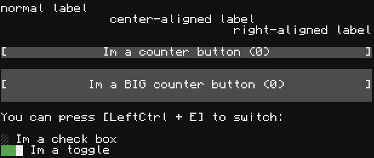
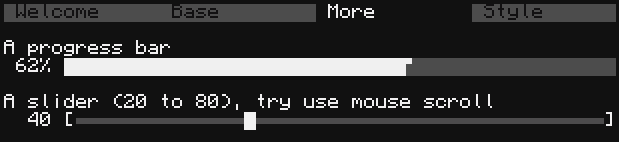
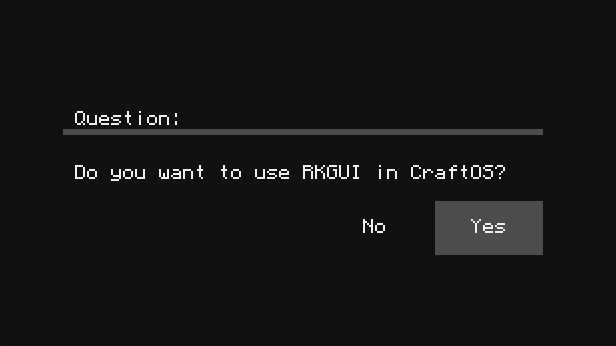
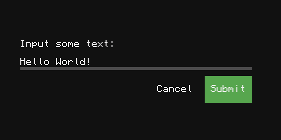
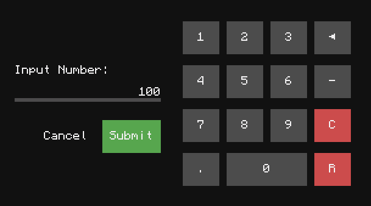
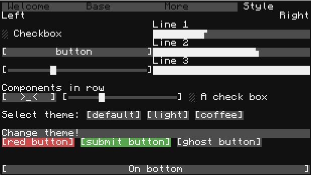

# RKGUI — A simple IMGUI-style TUI library for CraftOS

RKGUI 是一个运行在 CraftOS / ComputerCraft / CC:Tweaked 上的字符 GUI 库，设计风格类似 ImGui，让你可以用极少的代码快速构建交互式界面。

### 特性

- 极简的 API，无需维护复杂状态，调用即绘制
- 组件完善：按钮、文本、输入框、Dialog、布局
- 可自定义主题，自由搭配色彩
- 自定义组件非常简单
- 触摸屏支持，可以在 MC 世界中通过显示器交互

例子：点击按钮显示 `Hallo, World!`：

```lua
local rkgui = require 'rkgui'
local dialog = require 'rkgui.dialog'

local app = rkgui.new()
app:start(function()
    if app:button("Click me!") then
        dialog.alert('Hello, World!')
    end
end)
```

### 组件展示

> 运行 `example` 目录中的 `demo.lua` 即可看到完整的组件展示 demo，这里提供一些截图

标签、按钮、复选框、开关：



标签页、进度条、滑动条：



确认窗口：



文字输入：



数字输入：



灵活的排版和样式：




